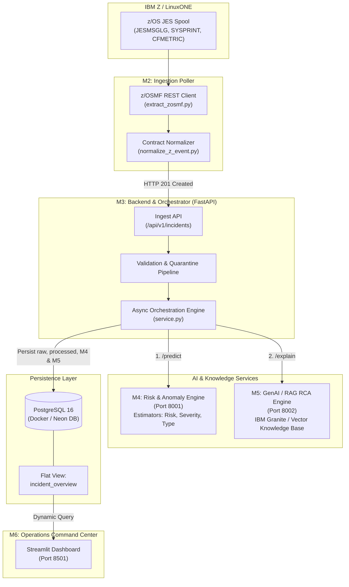

<div align="center">

# 🚨 CriticalFlow AI

### Intelligent Incident Detection, Predictive Risk Scoring & Automated Root Cause Analysis for IBM Z® / LinuxONE

[](LICENSE)
[](https://www.python.org/)
[](https://fastapi.tiangolo.com/)
[](https://streamlit.io/)
[](https://www.postgresql.org/)
[](https://www.docker.com/)

[Architecture](#-system-architecture) •
[Modules](#-system-modules) •
[Quick Start](#-quick-start) •
[API Reference](#-api-reference) •
[Demo Scenarios](#-demo-operational-scenarios) •
[Production Deployment](#-production-deployment-checklist)

</div>

---

## 📌 Overview

**CriticalFlow AI** is an enterprise-grade incident intelligence and automated root cause analysis (RCA) platform purpose-built for mission-critical **IBM Z® mainframe and LinuxONE** operational environments.

Traditional mainframe triage requires senior systems programmers to manually dig through vast JES spool logs (`JESMSGLG`, `SYSPRINT`, `JESYSMSG`), decode cryptic system/user completion codes (e.g., `S0C4`, `S806`), correlate operational metrics, and search manual runbooks. **CriticalFlow AI automates this entire lifecycle in real time:**

1. **Continuous Harvest**: Ingests job outputs, completion codes, and performance metrics from IBM z/OSMF REST APIs.
2. **Standardization & Quarantine**: Validates event structures against strict JSON Schema contracts with at-least-once delivery guarantees.
3. **Machine Learning Anomaly Detection**: Predicts incident severity and computes anomaly scores using trained Scikit-learn models.
4. **GenAI Root Cause Analysis (IBM Granite / RAG)**: Explains the exact failure mechanism using domain runbooks and recommends actionable operational remediation.
5. **Real-time Command Center**: Presents metrics, risk distributions, execution logs, and scenario drill-downs via an interactive Streamlit operations dashboard.

---

## 🏗 System Architecture



---

## 🧩 System Modules

| Module | Role | Tech Stack | Highlights |
| :--- | :--- | :--- | :--- |
| **`m2_ibmz`** | **IBM Z Spool Extractor** | Python, HTTPX, JSONSchema | Real-time z/OSMF REST poller, atomic checkpointing, offline mock dataset replay, CFMETRIC parser. |
| **`m3-backend`** | **Core API & Orchestrator** | FastAPI, SQLAlchemy 2, Psycopg 3 | Contract validation, quarantine routing, idempotent upserts, background AI dispatch, unified SQL views. |
| **`m4-prediction`** | **Risk & Anomaly Engine** | FastAPI, Scikit-learn, Joblib | Computes multi-class incident types, continuous anomaly scores, and categorical risk severity (`LOW` to `CRITICAL`). |
| **`rag` (M5)** | **GenAI Root Cause Analysis** | FastAPI, ChromaDB, IBM Granite | Vector retrieval over mainframe abend reference manuals and operational runbooks; generates evidence-backed remediation. |
| **`m6_dashboard`**| **Operations Dashboard** | Streamlit, Pandas, Altair | Dark-mode command center with high-level operational KPIs, risk distribution charts, system health, and deep log viewer. |

---

## 🚀 Quick Start

### Prerequisites
* [Docker Desktop](https://www.docker.com/products/docker-desktop/) (v24.0+)
* [Docker Compose](https://docs.docker.com/compose/) (v2.20+)
* Optional for local development: Python 3.10+ & Git

### 1. Clone & Configure
```bash
git clone https://github.com/forgedbykrishna/criticalflow-ai.git
cd criticalflow-ai
cp .env.example .env
```

### 2. Start Services via Docker Compose
Run the entire platform with a single command:
```bash
docker compose --profile dashboard up -d --build
```

### 3. Verify Health & Running Services
```bash
docker compose ps
```
All services should be `Up (healthy)`:

| Service | Port | Endpoint URL | Description |
| :--- | :---: | :--- | :--- |
| **Streamlit Dashboard** | `8501` | [http://localhost:8501](http://localhost:8501) | Incident Intelligence Operations Center |
| **M3 Backend API** | `8000` | [http://localhost:8000/docs](http://localhost:8000/docs) | Interactive Swagger Documentation |
| **M4 Prediction API** | `8001` | [http://localhost:8001/docs](http://localhost:8001/docs) | ML Risk & Severity Scoring Engine |
| **M5 LLM API** | `8002` | [http://localhost:8002/docs](http://localhost:8002/docs) | GenAI RCA & Runbook Recommendation |
| **PostgreSQL** | `5432` | `localhost:5432` | CriticalFlow Data Store |

---

## 🧪 Demo Operational Scenarios

The system includes pre-configured realistic IBM Z operational scenarios ready for replay:

| Scenario | Job Name | System | Event Type | Return Code | Simulated Condition |
| :--- | :--- | :--- | :--- | :--- | :--- |
| **Scenario 1** | `PAYSETL1` | `SYSA` | `JOB_SUCCESS` | `CC 0000` | Normal production batch run |
| **Scenario 2** | `PAYAUTH2` | `SYSA` | `JOB_ABEND` | `S0C4` | Protection exception / memory storage violation |
| **Scenario 3** | `GLPOST03` | `SYSA` | `JCL_ERROR` | `JCL ERROR` | Missing cataloged dataset |
| **Scenario 4** | `PAYGATE4` | `SYSB` | `JOB_FAILURE` | `CC 0008` | Resource exhaustion / JVM Heap limit reached |

### Stream Incidents to the Live System
To trigger the end-to-end flow and send these scenarios through the live pipeline into the dashboard:

```bash
# Ingest unique instances of all 4 scenarios into M3 -> M4 -> M5 -> PostgreSQL
python m2_ibmz/verify_integration.py --unique
```

Open [http://localhost:8501](http://localhost:8501) and view the updated metrics, risk bars, and root cause analyses immediately.

---

## 📡 API Reference

### Core Endpoints

* `POST /api/v1/incidents` — **Primary Mainframe Ingestion Endpoint**
  * Ingests single incident conforming to Contract 1.0.0.
  * Answers with `201 Created` for new incidents, `200 OK` for duplicates (idempotent), or `422 Unprocessable Entity` for invalid payloads (quarantined).
  * Automatically dispatches asynchronous M4 and M5 inference.

* `GET /api/v1/incidents/{incident_id}/full` — **Unified Incident Payload**
  * Returns event telemetry, ML prediction results, and LLM root-cause explanations in a single aggregated JSON payload.

* `GET /api/v1/events/quarantine` — **Quarantined Events**
  * Inspect records rejected due to schema violations or unknown attributes.

* `GET /health` — **Service Health & Upstream Status**
  * Reports database connectivity and status of M4 and M5 connections.

---

## 📋 Production Deployment Checklist

Before deploying CriticalFlow AI to production or cloud environments:

- [ ] **Change Default Passwords**: Replace default `POSTGRES_PASSWORD=postgres` in `.env` with a secure credential.
- [ ] **Configure API Security**: Set `API_KEY` in `.env` to enforce Bearer token authentication on all ingestion endpoints.
- [ ] **External Database Integration**: To connect to a cloud database (e.g., Neon PostgreSQL, AWS RDS, GCP Cloud SQL), set `DASHBOARD_DATABASE_URL` and `DATABASE_URL` in `.env`.
- [ ] **Live z/OSMF Polling**: When connecting to live LPARs:
  - Populate `ZOSMF_URL`, `ZOSMF_USER`, and `ZOSMF_PASSWORD` in `.env`.
  - Start with `--profile live-zosmf`:
    ```bash
    docker compose --profile live-zosmf --profile dashboard up -d
    ```
- [ ] **Reverse Proxy & Ingress**: Configure Nginx, Traefik, or Caddy with SSL/TLS termination and enable WebSocket forwarding (`/_stcore/stream`) for Streamlit.

---

## 🧪 Testing

Run comprehensive test suites across components:

```bash
# Run M3 Backend unit & integration tests inside Docker
docker exec criticalflow-ai-m3-backend-1 pytest tests/unit

# Run M6 Dashboard database & normalization tests
pytest m6_dashboard/tests/test_dashboard_db.py

# Offline replay of M2 IBM Z scenarios vs golden records
python m2_ibmz/verify_integration.py --no-post
```

---

## 📄 License

This project is licensed under the MIT License — see the [LICENSE](LICENSE) file for details.
